<p align="center">
  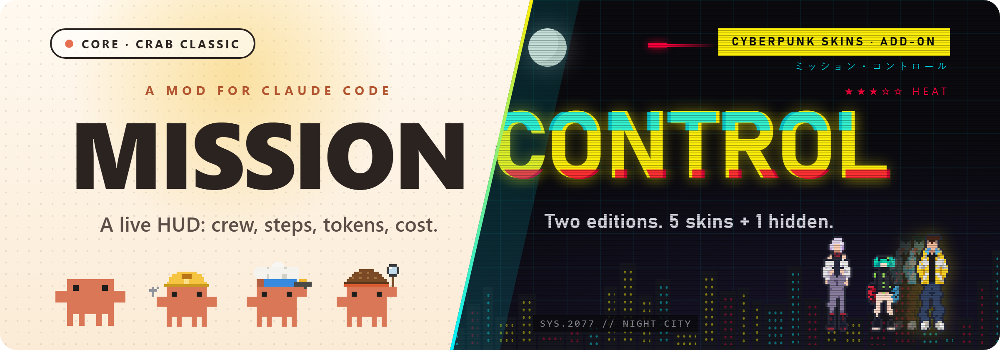
</p>

<h3 align="center">See everything Claude is doing. Live.</h3>

<p align="center">
  A live HUD and dashboard for <a href="https://claude.com/claude-code">Claude Code</a> (desktop app and CLI):<br>
  who's working, on what, how far along, and what it costs.
</p>

<p align="center">
  <a href="#-choose-your-edition">Download</a> ·
  <a href="#-what-mission-control-does">Features</a> ·
  <a href="#-what-the-cyberpunk-skins-add">Cyberpunk Skins</a> ·
  <a href="#-skin-showcase">Skins</a> ·
  <a href="#-install">Install</a> ·
  <a href="#-commands">Commands</a>
</p>

<p align="center">
  
  
  
</p>

---

## 🎯 Choose your edition

<table align="center">
  <tr>
    <td align="center" width="50%" valign="top">
      <a href="https://github.com/Chinchuan24/MissionControl/releases/latest/download/mission-control-core.zip">
        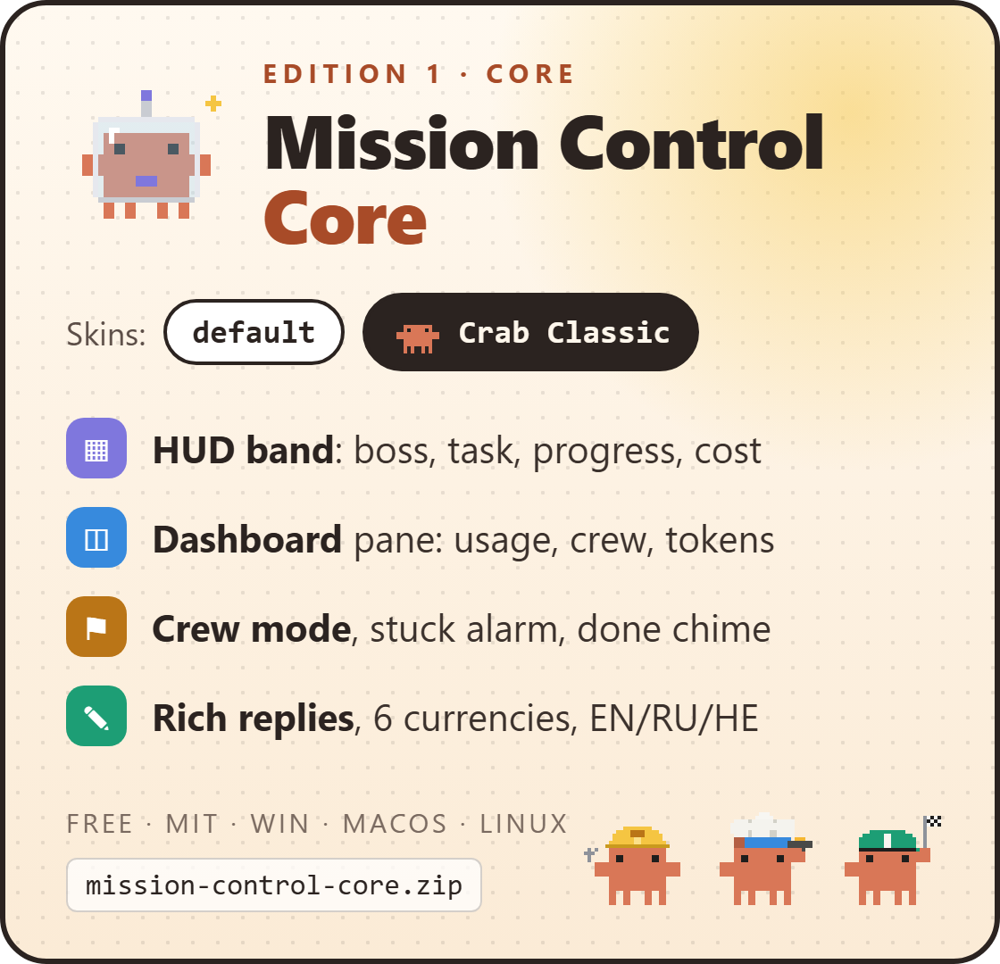
      </a>
    </td>
    <td align="center" width="50%" valign="top">
      <a href="https://github.com/Chinchuan24/MissionControl/releases/latest/download/mission-control-cyberpunk.zip">
        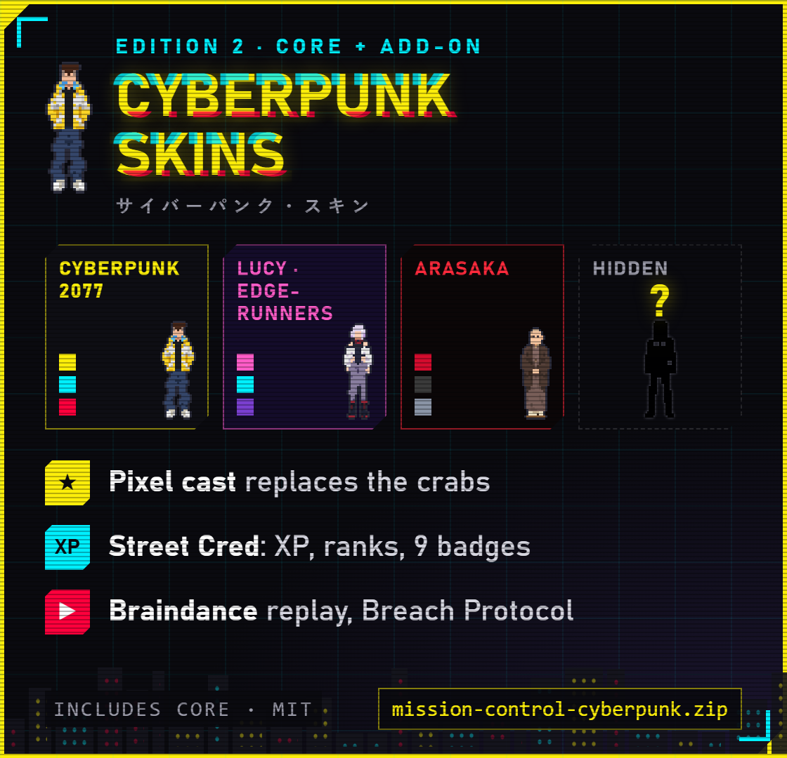
      </a>
    </td>
  </tr>
  <tr>
    <td align="center" valign="top">
      <b>The live dashboard.</b><br>Clean, light, free.
    </td>
    <td align="center" valign="top">
      <b>Jack in, choom.</b><br>Your crew just moved to Night City.
    </td>
  </tr>
  <tr>
    <td align="center" valign="top">
      <a href="https://github.com/Chinchuan24/MissionControl/releases/latest/download/mission-control-core.zip">
        
      </a>
    </td>
    <td align="center" valign="top">
      <a href="https://github.com/Chinchuan24/MissionControl/releases/latest/download/mission-control-cyberpunk.zip">
        
      </a><br>
      <sub>Have Core already? <a href="https://github.com/Chinchuan24/MissionControl/releases/latest/download/cyberpunk-skins-addon.zip">Get the add-on only</a>.</sub>
    </td>
  </tr>
</table>

<p align="center"><sub>Both zips are the full mod (Cyberpunk = Core + add-on). Unzip, <a href="#-install">point Claude Code at the folder</a>, restart.</sub></p>

> **Unofficial, non-commercial fan project.** Not affiliated with, endorsed by or sponsored by CD PROJEKT S.A., CD PROJEKT RED, Studio Trigger or Netflix. Cyberpunk 2077, Cyberpunk: Edgerunners and all related names, characters and terms belong to their respective owners and are used as fan homage only. The MIT license covers this project's code, not those properties. Removal requests: open an issue.

---

## 🧭 What Mission Control does

Claude works in steps, calls tools and spins up sub-agents. Mission Control shows it all at a glance.

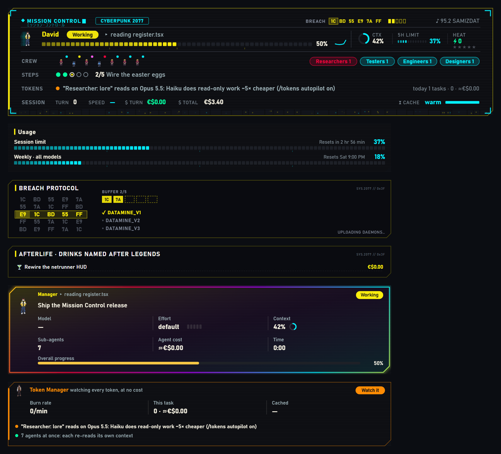

- 📊 **HUD band** above the prompt, always on: the boss, the task, what it's doing now, a progress gauge
- 🧪 **Readouts**: context, 5-hour limit, burn rate, tok/s, turn and total cost, prompt-cache countdown
- 👥 **Crew** and 🪜 **Steps**: every sub-agent by role, the plan as pips
- 💸 **Token Manager**: cost per task, cache hits, budget warnings; optional **Haiku autopilot** for read-only explorers
- 🧊 **Smart Keep-Warm**: refreshes the prompt cache just before it expires, only when that saves more than it costs (`/tokens warm on`)
- 🗓️ **Spend card**: what Today, this week (Mon–Sun), one calendar month or your own date range cost, read from Claude Code's own history (`/tokens spend week`, `/tokens spend month 2026-06`, `/tokens spend 2026-10-01 2026-10-15`); `/tokens export` saves the period as a FinOps-style CSV in Downloads ([Athena sample](docs/athena.sql))
- 🚀 **Crew mode**: big jobs get split across sub-agents automatically
- 🚨 **Stuck alarm** (2 min quiet) and 🔔 **done chime** (toast, notification, sound)
- 🧾 **Rich replies**: diffs, code, tables, math and mermaid as cards
- 🌍 **7 currencies**, **3 languages** (English, Russian, Hebrew)
- 🎨 **Skins**: `default` (the app's own look) and **Crab Classic** (a crab in costume per role), or [make your own](skins/README.md)

<details>
<summary><b>The <code>/missioncontrol</code> pane, section by section</b></summary>
<br>

| Section | What's in it |
|---|---|
| **Usage** | Your limits, plus tokens per model for this session and all time |
| **Today** | Tasks, agents, tokens and cost |
| **Workflow** | The plan's steps, live |
| **Manager** | The boss card: model, effort, sub-agents, cost and time |
| **Token Manager** | Burn rate, cost per task, cache hits, budget warnings, optional Haiku autopilot and Smart Keep-Warm |
| **Crew** | Every agent by role in one long list, however big the crew, plus a hierarchy from the manager down. **Collapse** folds the whole list into a short view; **▾ Finished** folds finished agents and steps into one line each. Both are remembered. |
| **Memory** | Answer rules Claude follows in every session (`/prefs`) |
| **Settings** | ☑ open on start · ☑ crew mode · currency · ☑ sounds · change skin |

</details>

<details>
<summary><b>🧊 Smart Keep-Warm, how it works</b></summary>
<br>

Claude's prompt cache keeps your conversation for an hour after each answer. Reading it costs about a tenth of the normal price; once it expires, your next prompt pays to write the whole conversation again (about 2× the normal price). Keep-Warm sends one tiny side request a few minutes before the hour runs out, so the cache stays warm.

- 🙈 **Never in your chat**: the refresh is a side request over your own conversation; nothing is added to it.
- 🧮 **Only when it pays**: it goes out only when the expected saving beats its cost by at least $0.05. Small conversations are left alone.
- 🏃 **Knows when you'll be back**: while agents or background tasks still run, you're sure to return, so it keeps going (up to 12 refreshes). Idle, it stops after 3 (close to three more warm hours).
- 🗜️ **Skips a dying context**: at 85%+ context a `/compact` is coming, which rewrites the cache anyway.
- 📊 **Shows its work**: each refresh's cost and saving in a toast and in the Token Manager; `/tokens` totals them.
- ⏸️ **Pauses itself** if a refresh finds the cache already gone, until your next prompt.

Off by default: turn it on with `/tokens warm on`. On a Pro or Max plan there's no per-token bill, so each refresh uses a little quota instead; the gain is mostly speed.

</details>

---

## 🌃 What the Cyberpunk Skins add

The add-on swaps the crabs for a pixel-art cast, moves the HUD to Night City and adds a progression system.

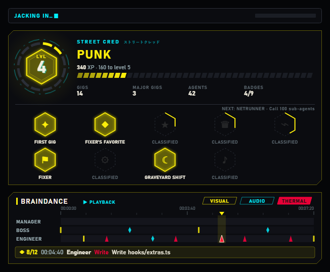

| Feature | Core | Cyberpunk |
|---|:---:|:---:|
| HUD band, pane, crew, Token Manager, crew mode, done chime, rich replies | ✓ | ✓ |
| `default` and Crab Classic skins, custom JSON skins | ✓ | ✓ |
| **Cyberpunk Edgerunner**, **Lucy · Edgerunners**, **Arasaka** skins + a hidden one 🎸 | — | ✓ |
| Pixel-art cast: David, Lucy, Rebecca, Maine, Kiwi, Johnny… Saburo and Adam Smasher on Arasaka | — | ✓ |
| **Street Cred**: XP per job, ranks NOBODY → LEGEND OF THE AFTERLIFE, 9 badges | — | ✓ |
| **Braindance**: replay the session, every tool call a mark | — | ✓ |
| Breach Protocol card, NCPD heat stars, CYBERPSYCHOSIS / MAXTAC warnings | — | ✓ |
| Night City skyline, Relic glitch, Sandevistan afterimages, the Afterlife | — | ✓ |
| Per-skin sound packs, eddies (€$), radio, street slang | — | ✓ |

---

## 🎨 Skin showcase

Pick one with `/skins` (a live picker) or `/skin <id>`. Each skin restyles the band, the pane, the chat's tool rows and the spinner.

| Skin | id | One line |
|---|---|---|
| default | `default` | Keeps the app's own look. Just the data. |
| 🦀 Crab Classic | `crab-classic` | The original. A working crab in costume for every role. |
| 🟡 Cyberpunk Edgerunner | `cyberpunk-2077` | Neon yellow, cyan and hot red. David leads the crew. |
| 🌙 Lucy · Edgerunners | `lucy-edgerunners` | Rose-pink and cyan under the moon. Lucy runs the net. |
| 🔴 Arasaka | `arasaka` | Corporate red and black. Saburo at the top, Smasher on call. |
| 🎸 ??? | — | Not in the picker. Wake up… |

<details open>
<summary><b>⚪ default</b> · Core</summary>
<br>

The app's own colours and fonts, with no costumes or effects. Just the data.

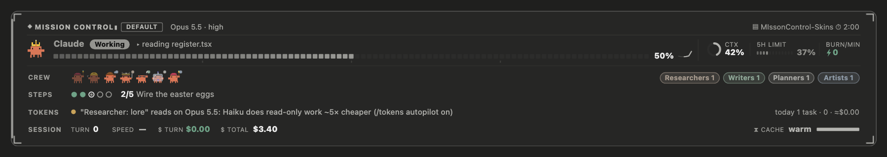
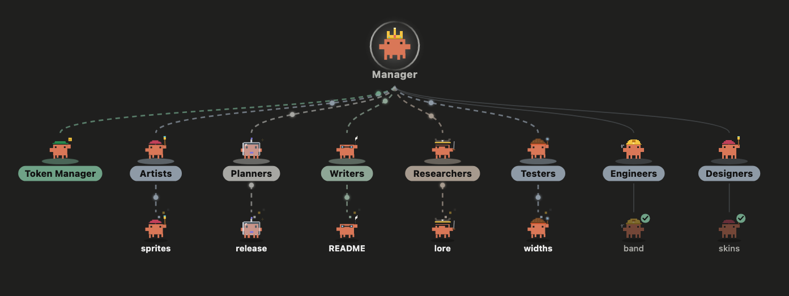

</details>

<details>
<summary><b>🦀 Crab Classic</b> · Core</summary>
<br>

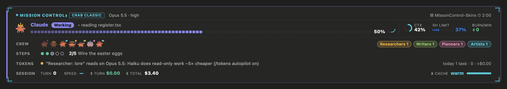
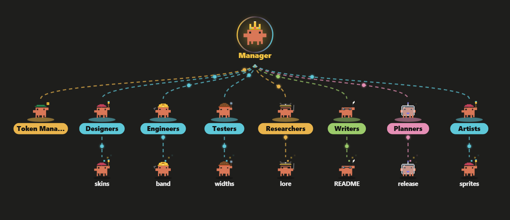

</details>

<details>
<summary><b>🟡 Cyberpunk Edgerunner</b> · add-on</summary>
<br>

Night City HUD: neon yellow, cyan and hot red, cut corners and scanlines. **David** leads. **Lucy, Rebecca, Maine, Dorio, Kiwi, Pilar, Falco and Johnny** take the roles; chooms and NPCs do the work.

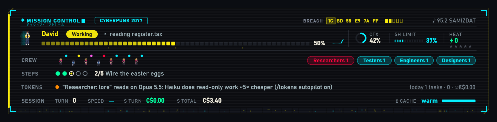
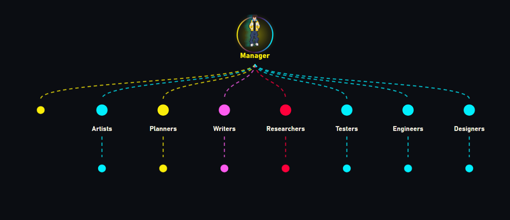

</details>

<details>
<summary><b>🌙 Lucy · Edgerunners</b> · add-on</summary>
<br>

Moonlit netrunner: rose-pink and cyan on deep violet, with the moon in the skyline. **Lucy** leads, and **David** rides with the crew.

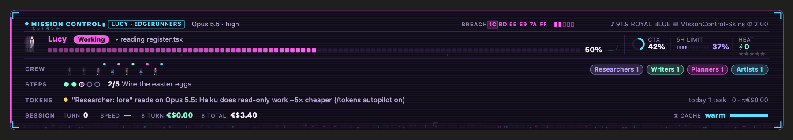
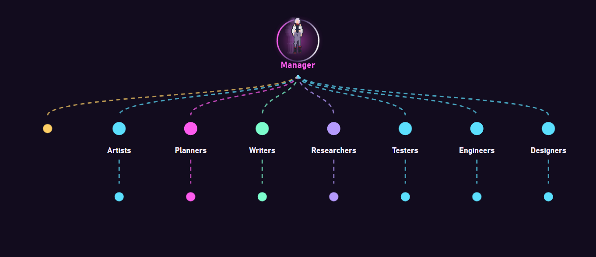

</details>

<details>
<summary><b>🔴 Arasaka</b> · add-on</summary>
<br>

Corporate red and black. **Saburo** at the top. **Adam Smasher**, handlers, agents, netrunners, guards, a cyborg and a captive **Johnny** under him. Troopers, salarymen and drones on the floor. The tower stands in the skyline.

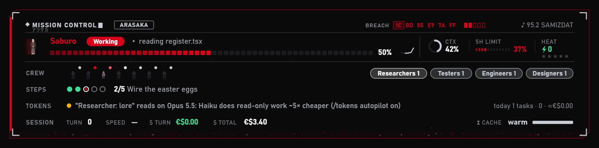
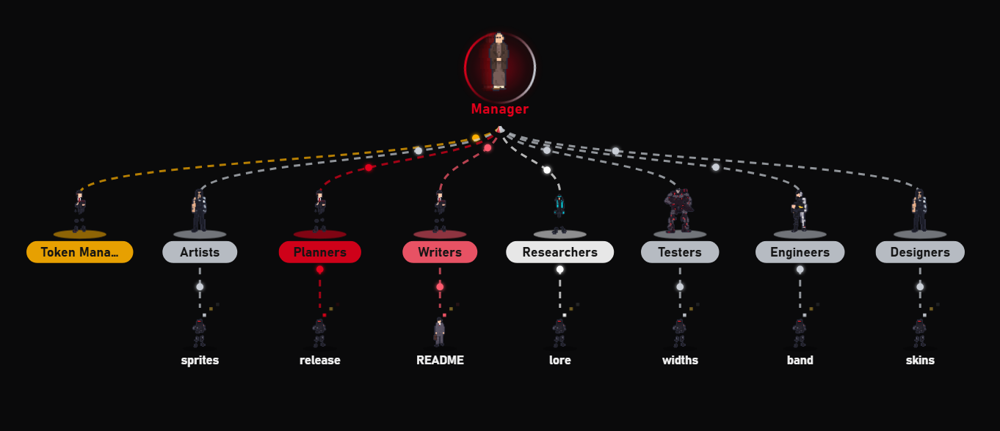

</details>

<details>
<summary><b>🛠 Make your own skin</b></summary>
<br>

Skins are small `.json` files; see [`skins/README.md`](skins/README.md) for every field. They load from, in order:

1. the folder you used last
2. a `Custom Claude Skins/` folder in your working folder
3. this repo's `skins/` examples

Copy an example, give it a new `id`, edit it, then run `/skin reload` and `/skin <id>`.

Or skip the editing: `/skin new ocean sunset` drafts one for you, and `/skin check <file>` checks one. See [`docs/SKINS.md`](docs/SKINS.md) for the guide, the schema and how to share a skin (Skin jam).

</details>

---

## 🛡️ Machine Guard

Stops a big crew from freezing your computer.

- **You set the RAM Claude may use** (Auto 50%, 25/50/75%, or a typed GB). Max agents = that RAM ÷ RAM per agent (≈0.5 GB, learned on your machine). 15 GB means up to 30 agents; no cap of 8.
- **Claude is told** the limit and the max in chat, and you get a toast when you change it.
- **Watches RAM live.** Over the limit, it refuses *new* agents and new heavy commands.
- **One budget across all your sessions.** Run 2 or 3 sessions and they share the same limit: the agent count adds up across them, and only one heavy command runs at a time on the whole computer.
- **One heavy command at a time** (tsc, tests, builds): a second one waits, up to 5 minutes.
- **🔪 Kill switch (On by default).** If Claude goes over its RAM limit, the guard stops the single biggest heavy process under Claude (a runaway `tsc`, a test run), then tells you and Claude. It never touches Claude itself, your apps, MCP servers or shells. Switch it off in Settings.
- **Tune it** in ⚙ Settings: "RAM Claude may use", "Max agents at once" (Auto, a list, or a typed number) and "Kill switch".
- **Claude's RAM counts every Claude process** on the computer: other sessions and the desktop app too.
- **See it** in the desktop pane: "🛡 RAM 9.1/15 GB · 3/30 agents" while working, plus "· 2 sessions" when more than one is live.

Details: [docs/MACHINE-GUARD.md](docs/MACHINE-GUARD.md)

---

## 🔒 Privacy: nothing leaves your machine

- **No network calls of its own.** Costs, the spend history and the crew view are all worked out locally, from Claude Code's own logs.
- **Model features are opt-in.** Keep-Warm, `/skin new` and the stuck-agent buttons use Claude Code's own connection, only when you turn them on or click them.
- **Your API key stays in the macOS Keychain.** The mod never stores it in its own files.
- **Check it yourself:** `scripts/check-privacy.sh` fails if network code ever appears.

Details: [docs/PRIVACY.md](docs/PRIVACY.md)

---

## ⚡ Install

### Fastest: one line

At the prompt of a terminal session:

```
/plugin install crab-progress --marketplace Chinchuan24/MissionControl
```

Or from a shell:

```
claude plugin install crab-progress --marketplace Chinchuan24/MissionControl
```

Answer `y` to add the marketplace, then pick a scope (user is first). In the desktop app, where `/plugin` does not run: click **+** next to the prompt box, then **Plugins**, **Add marketplace** with `Chinchuan24/MissionControl`, then **Add plugin**. This installs the full mod, Cyberpunk add-on included. Then run `/missioncontrol`.

### By hand, from a zip or a clone

**1. Get it** (one of):

- Download a zip above and unzip it anywhere. It holds one folder, `mission-control/` (the one with `.claude-plugin/` inside): that is the folder to point Claude Code at. Windows' "Extract All" may wrap it in a second folder; use the inner one. Or
- clone the repo (this gets everything, add-on included):
  ```
  git clone https://github.com/Chinchuan24/MissionControl.git
  ```
  A clone has no `mission-control/` folder: point Claude Code at the cloned `MissionControl/` folder itself (it holds `.claude-plugin/`).

**2. Point Claude Code at the folder** in `~/.claude/settings.json` (Windows: `C:\Users\<you>\.claude\settings.json`):

```json
{
  "env": {
    "CLAUDE_CODE_PLUGIN_DIRS": "/path/to/mission-control",
    "CLAUDE_CODE_PLUGIN_DIR_WATCH": "1"
  }
}
```

- **Windows:** write the path with forward slashes or doubled backslashes, e.g. `"C:/Users/<you>/mission-control"` or `"C:\\Users\\<you>\\mission-control"`. A single `\` breaks the JSON.
- Several mod folders: separate them with `;` on **Windows**, `:` on **macOS / Linux**.
- **WSL:** the CLI there is Linux: use the WSL `~/.claude/settings.json`, `:` separators and `/mnt/c/...` paths.
- Keep the mod on a local drive: network and `\\wsl.localhost` paths can hide the skins and the add-on.
- `CLAUDE_CODE_PLUGIN_DIR_WATCH=1` reloads the mod when its files change.

**3. Restart Claude Code**, then run `/missioncontrol` and `/skins`. On a Mac, quit the desktop app with ⌘Q and open it again.

<details>
<summary><b>Adding the Cyberpunk add-on to an existing Core install</b></summary>
<br>

Unzip [`cyberpunk-skins-addon.zip`](https://github.com/Chinchuan24/MissionControl/releases/latest/download/cyberpunk-skins-addon.zip) **into** your Mission Control folder. It creates `addons/cyberpunk/`. Restart Claude Code, then pick a skin with `/skins`.

On a Mac, double-clicking the zip unzips it into a folder of its own, and dragging `addons/` onto your install in Finder replaces the folder instead of merging it. Unzip it from Terminal instead:

```
unzip -o ~/Downloads/cyberpunk-skins-addon.zip -d /path/to/mission-control
```

On Windows, "Extract All" also makes a folder of its own. In PowerShell instead:

```
Expand-Archive -Force "$env:USERPROFILE\Downloads\cyberpunk-skins-addon.zip" -DestinationPath "C:\path\to\mission-control"
```

</details>

- Works on Windows, macOS and Linux.
- 🔈 Sounds play on macOS and in the Claude Desktop app; Linux/Windows terminals stay silent.
- Optional: the free **Rajdhani** font gives the true HUD look (otherwise your OS's own sans is used).

---

## 💻 Commands

| Command | What it does |
|---|---|
| `/missioncontrol` | Open Mission Control (Settings at the bottom) |
| `/missioncontrol billing` | Pay with your own Claude API credits instead of the plan: 4 steps, key kept in the macOS Keychain ([security notes](docs/SECURITY-billing.md)) |
| `/missioncontrol currency <code> [rate]` | Costs in `USD` (the default), `AUTO` (eddies on the cyberpunk skins), `EDDIES`, `EUR`, `GBP`, `JPY`, `MYR` or `SGD`; optional rate per US dollar |
| `/missioncontrol oneshot <on\|off\|ask>` | Once you approve a plan: do it all and report once (`on`), one part at a time (`off`), or ask each time (`ask`) |
| `/skins` | The skin picker, every skin as a live preview |
| `/skin` | `/skin` to list, `/skin <id>` to switch, `/skin off`, `/skin reload` |
| `/autocrew` | Crew mode: state, `on` (big jobs only), `always` (every job, small ones too), `off`, or `<context %>` to call the crew |
| `/tokens` | Token Manager report, `budget <dollars\|off>`, `autopilot <on\|off>`, `warm <on\|off>` (Smart Keep-Warm), `staffing <on\|off>` (cheapest model and effort per crew job), `ultra <add\|remove\|list\|off> [role]` (max effort and a deep check for a role; the card shows "max + Ultra"), `spend today\|week\|month [YYYY-MM]\|<from> <to>`, `export [period]` (CSV in Downloads), `daily <dollars\|off>` (a soft daily cap), `receipt` (the job's markdown receipt, copied), `pr` (a PR cost badge, copied), `whatif` (this session re-priced under cheaper setups; Tab takes the best one's command), `rescue [retry\|nudge <n\|all>]` (quiet agents), `model <id or ARN> <opus\|sonnet\|haiku\|fable\|off>` (price a Bedrock application inference profile ARN, or any id with no model name, as that model; no args lists the map) |
| `/prefs` | How Claude should answer you, in every session: `add <rule>`, `remove <n>`, `clear` |

---

<details>
<summary><b>🔧 Development</b></summary>
<br>

- `hooks/register.tsx`: hooks, UI and commands
- `hooks/cast.ts`: the pixel casts
- `hooks/eggs.ts`: the easter eggs
- `hooks/richtext.ts`: diffs, tables, math and mermaid in replies
- `hooks/warm.ts`: Smart Keep-Warm's arithmetic (when a refresh pays)
- `hooks/billing.ts` and `scripts/anthropic-key-helper.sh`: the API key in the macOS Keychain and the `apiKeyHelper` link ([docs/SECURITY-billing.md](docs/SECURITY-billing.md))
- `hooks/spend.ts`: the spend card's periods, the transcript reader and per-day ledger, the CSV export
- Tests: `claude plugin test /path/to/MissionControl` (and `claude plugin validate …`)
- `.claude-plugin/types/` is generated on each machine by the CLI and is git-ignored.

</details>

## 🙏 Credits and license

- Started from **savvy-progress** by [johnnyvizz](https://github.com/johnnyvizz) ([claude-kit](https://github.com/johnnyvizz/claude-kit), MIT), since heavily reworked. Its copyright notice is kept in [LICENSE](LICENSE).
- Smart Keep-Warm was inspired by **cache-warmer** by [paulbkim-dev](https://github.com/paulbkim-dev) ([claude-code-cache-warmer](https://github.com/paulbkim-dev/claude-code-cache-warmer), MIT), itself after [Pi](https://github.com/earendil-works/pi)'s cache warmer: the side-request refresh, the expected-value rule and the idle limit. Mission Control's version is its own code, built into the Token Manager.
- Character designs and pixel art: most were created by [Chinchuan24](https://github.com/Chinchuan24) with [Higgsfield](https://higgsfield.ai), then converted to sprite grids. The Crab Classic crab is based on Pixel Clawd from DockCrab (Clawdy). The done chime (`assets/done.wav`) was synthesised for this project.
- **Open source under the [MIT License](LICENSE)**: use it, fork it, remix it. Game and show names, characters and terms are not covered.

<p align="center"><sub>Stop guessing what Claude is up to. Open Mission Control and watch.</sub></p>
