<p align="center">
  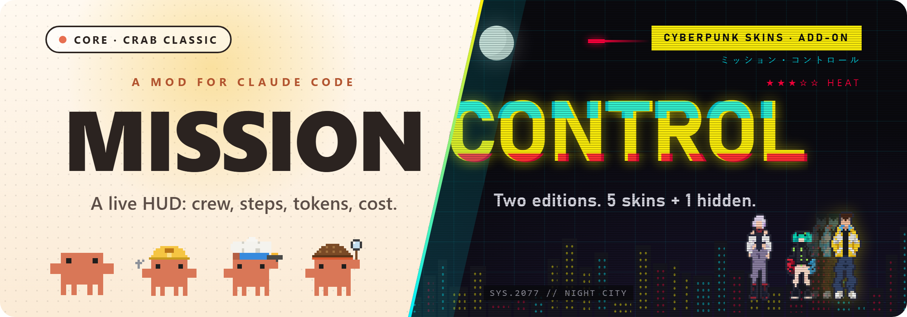
</p>

<h3 align="center">See everything Claude is doing. Live.</h3>

<p align="center">
  A live HUD and dashboard for <a href="https://claude.com/claude-code">Claude Code</a> (desktop app and CLI):<br>
  who's working, on what, how far along, and what it costs.
</p>

<p align="center">
  <a href="#-choose-your-edition">Download</a> ·
  <a href="#-what-mission-control-does">Features</a> ·
  <a href="#-what-the-cyberpunk-skins-add">Cyberpunk Skins</a> ·
  <a href="#-skin-showcase">Skins</a> ·
  <a href="#-install">Install</a> ·
  <a href="#-commands">Commands</a>
</p>

<p align="center">
  
  
  
</p>

---

## 🎯 Choose your edition

<table align="center">
  <tr>
    <td align="center" width="50%" valign="top">
      <a href="https://github.com/Chinchuan24/MIssonControl-Skins/releases/latest/download/mission-control-core.zip">
        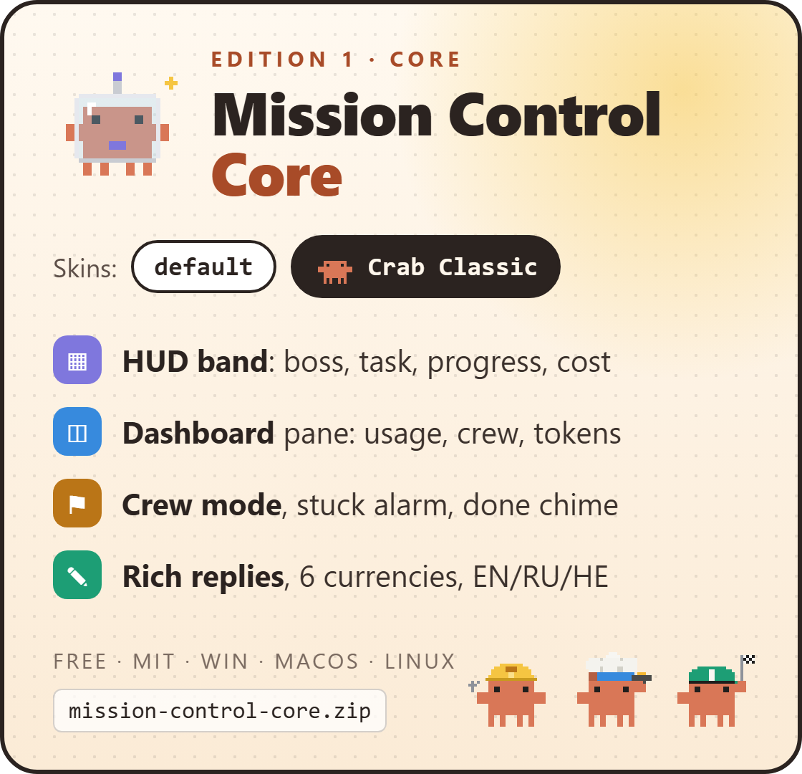
      </a>
    </td>
    <td align="center" width="50%" valign="top">
      <a href="https://github.com/Chinchuan24/MIssonControl-Skins/releases/latest/download/mission-control-cyberpunk.zip">
        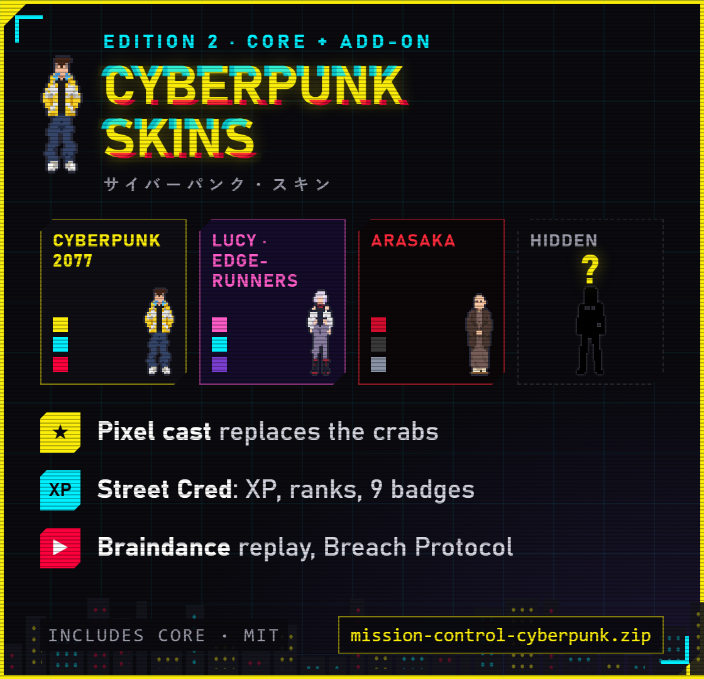
      </a>
    </td>
  </tr>
  <tr>
    <td align="center" valign="top">
      <b>The live dashboard.</b><br>Clean, light, free.
    </td>
    <td align="center" valign="top">
      <b>Jack in, choom.</b><br>Your crew just moved to Night City.
    </td>
  </tr>
  <tr>
    <td align="center" valign="top">
      <a href="https://github.com/Chinchuan24/MIssonControl-Skins/releases/latest/download/mission-control-core.zip">
        
      </a>
    </td>
    <td align="center" valign="top">
      <a href="https://github.com/Chinchuan24/MIssonControl-Skins/releases/latest/download/mission-control-cyberpunk.zip">
        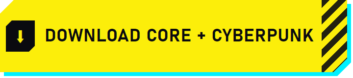
      </a><br>
      <sub>Have Core already? <a href="https://github.com/Chinchuan24/MIssonControl-Skins/releases/latest/download/cyberpunk-skins-addon.zip">Get the add-on only</a>.</sub>
    </td>
  </tr>
</table>

<p align="center"><sub>Both zips are the full mod (Cyberpunk = Core + add-on). Unzip, <a href="#-install">point Claude Code at the folder</a>, restart.</sub></p>

> **Unofficial, non-commercial fan project.** Not affiliated with, endorsed by or sponsored by CD PROJEKT S.A., CD PROJEKT RED, Studio Trigger or Netflix. Cyberpunk 2077, Cyberpunk: Edgerunners and all related names, characters and terms belong to their respective owners and are used as fan homage only. The MIT license covers this project's code, not those properties. Removal requests: open an issue.

---

## 🧭 What Mission Control does

Claude works in steps, calls tools and spins up sub-agents. Mission Control shows it all at a glance.

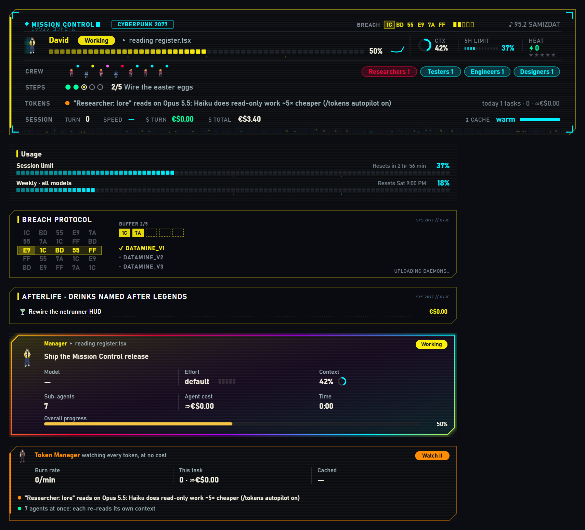

- 📊 **HUD band** above the prompt, always on: the boss, the task, what it's doing now, a progress gauge
- 🧪 **Readouts**: context, 5-hour limit, burn rate, tok/s, turn and total cost, prompt-cache countdown
- 👥 **Crew** and 🪜 **Steps**: every sub-agent by role, the plan as pips
- 💸 **Token Manager**: cost per task, cache hits, budget warnings; optional **Haiku autopilot** for read-only explorers
- 🚀 **Crew mode**: big jobs get split across sub-agents automatically
- 🚨 **Stuck alarm** (2 min quiet) and 🔔 **done chime** (toast, notification, sound)
- 🧾 **Rich replies**: diffs, code, tables, math and mermaid as cards
- 🌍 **6 currencies**, **3 languages** (English, Russian, Hebrew)
- 🎨 **Skins**: `default` (the app's own look) and **Crab Classic** (a crab in costume per role), or [make your own](skins/README.md)

<details>
<summary><b>The <code>/missioncontrol</code> pane, section by section</b></summary>
<br>

| Section | What's in it |
|---|---|
| **Usage** | Your limits, plus tokens per model for this session and all time |
| **Today** | Tasks, agents, tokens and cost |
| **Workflow** | The plan's steps, live |
| **Manager** | The boss card: model, effort, sub-agents, cost and time |
| **Token Manager** | Burn rate, cost per task, cache hits, budget warnings, optional Haiku autopilot |
| **Crew** | Every agent by role (finished ones fold away), plus a hierarchy from the manager down |
| **Memory** | Answer rules Claude follows in every session (`/prefs`) |
| **Settings** | ☑ open on start · ☑ crew mode · currency · ☑ sounds · change skin |

</details>

---

## 🌃 What the Cyberpunk Skins add

The add-on swaps the crabs for a pixel-art cast, moves the HUD to Night City and adds a progression system.

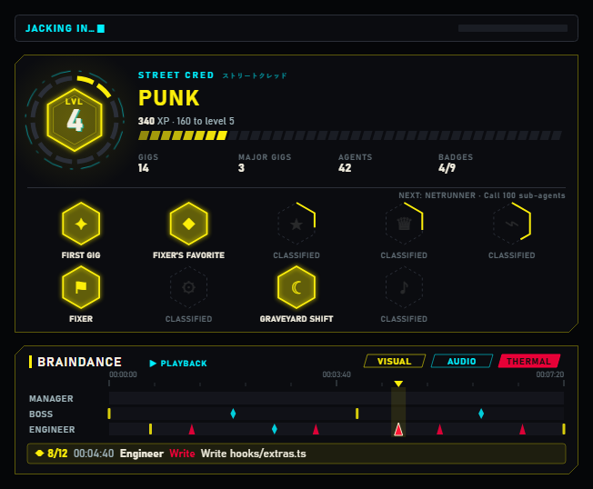

| Feature | Core | Cyberpunk |
|---|:---:|:---:|
| HUD band, pane, crew, Token Manager, crew mode, done chime, rich replies | ✓ | ✓ |
| `default` and Crab Classic skins, custom JSON skins | ✓ | ✓ |
| **Cyberpunk 2077**, **Lucy · Edgerunners**, **Arasaka** skins + a hidden one 🎸 | — | ✓ |
| Pixel-art cast: David, Lucy, Rebecca, Maine, Kiwi, Johnny… Saburo and Adam Smasher on Arasaka | — | ✓ |
| **Street Cred**: XP per job, ranks NOBODY → LEGEND OF THE AFTERLIFE, 9 badges | — | ✓ |
| **Braindance**: replay the session, every tool call a mark | — | ✓ |
| Breach Protocol card, NCPD heat stars, CYBERPSYCHOSIS / MAXTAC warnings | — | ✓ |
| Night City skyline, Relic glitch, Sandevistan afterimages, the Afterlife | — | ✓ |
| Per-skin sound packs, eddies (€$), radio, street slang | — | ✓ |

---

## 🎨 Skin showcase

Pick one with `/skins` (a live picker) or `/skin <id>`. Each skin restyles the band, the pane, the chat's tool rows and the spinner.

| Skin | id | One line |
|---|---|---|
| default | `default` | Keeps the app's own look. Just the data. |
| 🦀 Crab Classic | `crab-classic` | The original. A working crab in costume for every role. |
| 🟡 Cyberpunk 2077 | `cyberpunk-2077` | Neon yellow, cyan and hot red. David leads the crew. |
| 🌙 Lucy · Edgerunners | `lucy-edgerunners` | Rose-pink and cyan under the moon. Lucy runs the net. |
| 🔴 Arasaka | `arasaka` | Corporate red and black. Saburo at the top, Smasher on call. |
| 🎸 ??? | — | Not in the picker. Wake up… |

<details open>
<summary><b>⚪ default</b> · Core</summary>
<br>

The app's own colours and fonts, with no costumes or effects. Just the data.

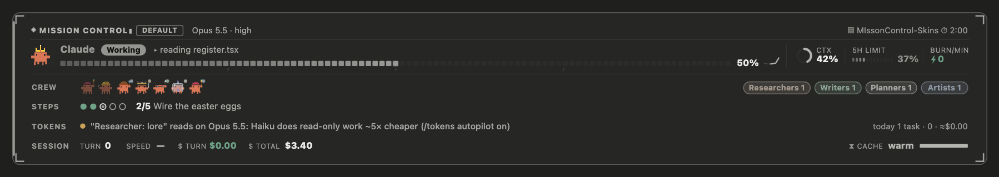
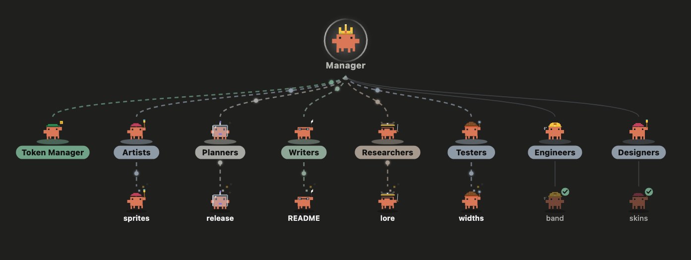

</details>

<details>
<summary><b>🦀 Crab Classic</b> · Core</summary>
<br>

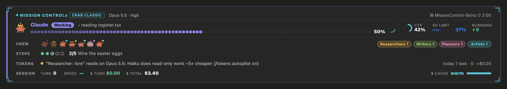
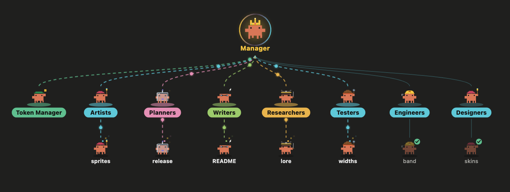

</details>

<details>
<summary><b>🟡 Cyberpunk 2077</b> · add-on</summary>
<br>

Night City HUD: neon yellow, cyan and hot red, cut corners and scanlines. **David** leads. **Lucy, Rebecca, Maine, Dorio, Kiwi, Pilar, Falco and Johnny** take the roles; chooms and NPCs do the work.

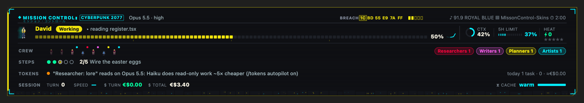
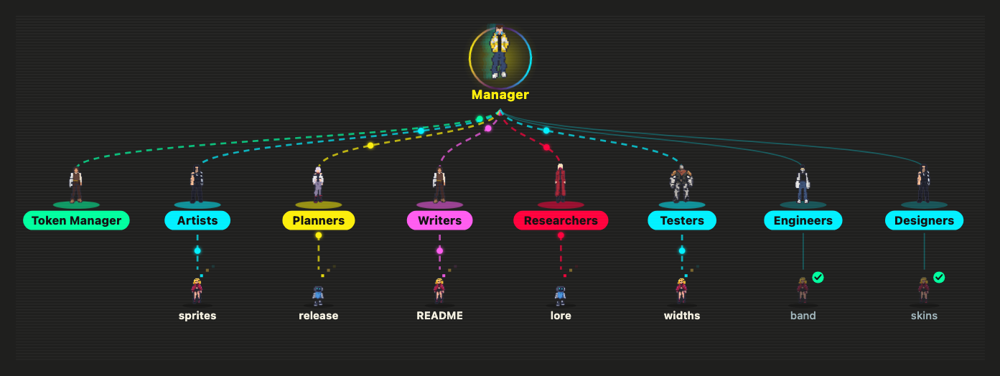

</details>

<details>
<summary><b>🌙 Lucy · Edgerunners</b> · add-on</summary>
<br>

Moonlit netrunner: rose-pink and cyan on deep violet, with the moon in the skyline. **Lucy** leads, and **David** rides with the crew.

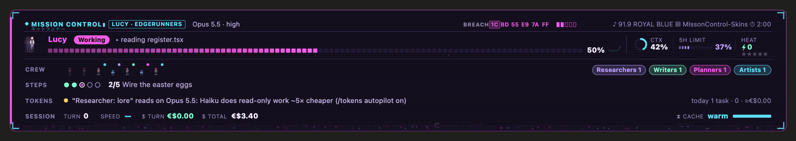
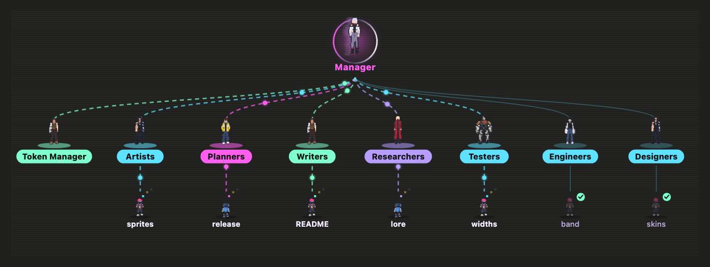

</details>

<details>
<summary><b>🔴 Arasaka</b> · add-on</summary>
<br>

Corporate red and black. **Saburo** at the top. **Adam Smasher**, handlers, agents, netrunners, guards, a cyborg and a captive **Johnny** under him. Troopers, salarymen and drones on the floor. The tower stands in the skyline.

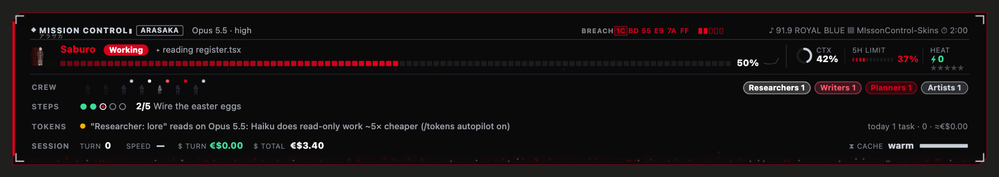
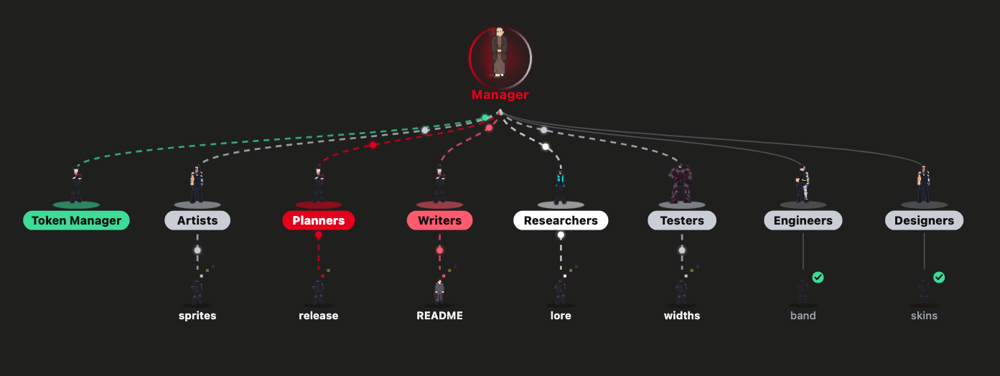

</details>

<details>
<summary><b>🛠 Make your own skin</b></summary>
<br>

Skins are small `.json` files; see [`skins/README.md`](skins/README.md) for every field. They load from, in order:

1. the folder you used last
2. a `Custom Claude Skins/` folder in your working folder
3. this repo's `skins/` examples

Copy an example, give it a new `id`, edit it, then run `/skin reload` and `/skin <id>`.

</details>

---

## ⚡ Install

**1. Get it** (one of):

- Download a zip above and unzip it anywhere, or
- clone the repo (this gets everything, add-on included):
  ```
  git clone https://github.com/Chinchuan24/MIssonControl-Skins.git
  ```

**2. Point Claude Code at the folder** in `~/.claude/settings.json` (Windows: `C:\Users\<you>\.claude\settings.json`):

```json
{
  "env": {
    "CLAUDE_CODE_PLUGIN_DIRS": "/path/to/MIssonControl-Skins",
    "CLAUDE_CODE_PLUGIN_DIR_WATCH": "1"
  }
}
```

- Several mod folders: separate them with `;` on **Windows**, `:` on **macOS / Linux**.
- `CLAUDE_CODE_PLUGIN_DIR_WATCH=1` reloads the mod when its files change.

**3. Restart Claude Code**, then run `/missioncontrol` and `/skins`.

<details>
<summary><b>Adding the Cyberpunk add-on to an existing Core install</b></summary>
<br>

Unzip [`cyberpunk-skins-addon.zip`](https://github.com/Chinchuan24/MIssonControl-Skins/releases/latest/download/cyberpunk-skins-addon.zip) **into** your Mission Control folder. It creates `addons/cyberpunk/`. Restart Claude Code, then pick a skin with `/skins`.

</details>

- Works on Windows, macOS and Linux.
- 🔈 Sounds play on macOS and in the Claude Desktop app; Linux/Windows terminals stay silent.
- Optional: the free **Rajdhani** font gives the true HUD look (otherwise your OS's own sans is used).

---

## 💻 Commands

| Command | What it does |
|---|---|
| `/missioncontrol` | Open Mission Control (Settings at the bottom) |
| `/missioncontrol currency <code> [rate]` | Costs in `USD`, `EDDIES`, `EUR`, `GBP`, `JPY`, `MYR` or `SGD`; optional rate per US dollar |
| `/skins` | The skin picker, every skin as a live preview |
| `/skin` | `/skin` to list, `/skin <id>` to switch, `/skin off`, `/skin reload` |
| `/autocrew` | Crew mode: state, `on`, `off`, or `<context %>` to call the crew |
| `/tokens` | Token Manager report, `budget <dollars\|off>`, `autopilot <on\|off>` |
| `/prefs` | How Claude should answer you, in every session: `add <rule>`, `remove <n>`, `clear` |

---

<details>
<summary><b>🔧 Development</b></summary>
<br>

- `hooks/register.tsx`: hooks, UI and commands
- `hooks/cast.ts`: the pixel casts
- `hooks/eggs.ts`: the easter eggs
- `hooks/richtext.ts`: diffs, tables, math and mermaid in replies
- Tests: `claude plugin test /path/to/MIssonControl-Skins` (and `claude plugin validate …`)
- `.claude-plugin/types/` is generated on each machine by the CLI and is git-ignored.

</details>

## 🙏 Credits and license

- Based on **savvy-progress** from [johnnyvizz/claude-kit](https://github.com/johnnyvizz/claude-kit) (MIT).
- Pixel art: generated for this project in a fan-art style, then converted to sprite grids. The done chime (`assets/done.wav`) was synthesised for this project.
- **Open source under the [MIT License](LICENSE)**: use it, fork it, remix it. Game and show names, characters and terms are not covered.

<p align="center"><sub>Stop guessing what Claude is up to. Open Mission Control and watch.</sub></p>
